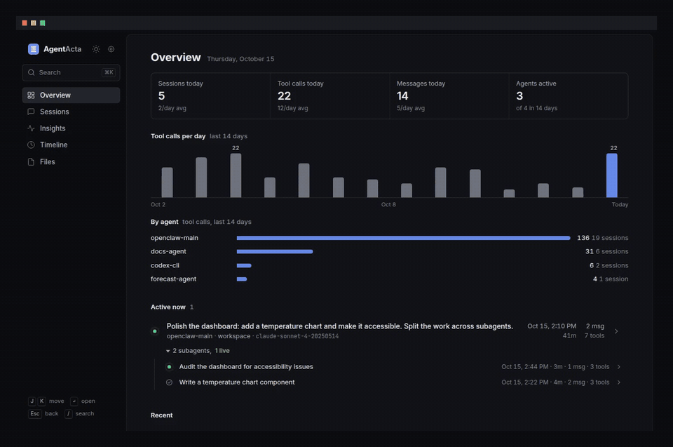

# AgentActa

[](https://github.com/mirajchokshi/agentacta/actions/workflows/ci.yml)
[](https://www.npmjs.com/package/agentacta)
[](LICENSE)

**The fastest open-source observability tool for the AI agents you run.**

AgentActa turns the logs your agents already write (Claude Code, Codex, OpenClaw) into a searchable history: every session, message, tool call and file edit, on your machine, with no SDK and no setup.

```bash
npx agentacta
```

<p align="center">
  
</p>

<p align="center"><a href="screenshots/demo.mp4">Full-quality video</a> · recorded from the bundled demo data (<code>npm run record-demo</code>)</p>

## Benchmark

Same history (4,400 sessions, 370,000 events), each tool driven through its own UI in Chrome. Median of 5 runs. [Method, caveats and scripts](bench/README.md).

| | AgentActa | agentsview | Langfuse |
|---|---:|---:|---:|
| Open the app | **80 ms** | 588 ms | 696 ms |
| Open a 30,000-event session | **124 ms** | 1,048 ms | 2,568 ms |
| Search a word | **105 to 116 ms** | 315 to 685 ms | 141 ms |
| Search inside tool output | **116 ms** | not found | not found |
| Restart with existing data | **0.3 s** | 0.6 s | 13.7 s |
| Memory | **125 MB** | 173 MB | 3.5 GB |

agentsview is the closest open-source tool (it also reads agent log files); Langfuse is the most popular open-source tracing platform. Each has features AgentActa doesn't, and the benchmark only measures speed. Anyone can rerun it: `bench/` sets everything up in Docker and removes it afterwards.

## What it does

- **Search everything.** Press ⌘K (or Ctrl+K, or `/`) and type: sessions, files and the text of messages, tool calls and tool output, matched as you type. Pick a match to open the session at that event.
- **Browse sessions.** Real titles, agent, project, model, duration and counts. Live and stale status at a glance, subagents nested under the session that started them, and older sessions load as you scroll.
- **Read one session.** Duration, messages, tool calls and tokens up top, a strip showing when it was busy, the tools it used most, then every event. Filter by project, jump to the first prompt, and watch new events arrive while it runs.
- **See your day.** The Overview compares today with your 14-day average and charts activity per day, per agent and per week. The Timeline shows any day's events grouped by session.
- **Spot trouble.** Insights scores every session for repeated tool loops, errors, missing output, vague instructions and unfinished work.
- **Follow files.** Which files were touched, how often and by which sessions.
- **Export.** Any session as Markdown or JSON.

It runs on phones as well as desktops, has light, dark and true-black themes, and supports keyboard navigation (J/K, Enter, Esc).

## Quick start

```bash
npx agentacta                 # run once
npm install -g agentacta      # or install it
agentacta
```

Then open <http://localhost:4003>. AgentActa finds your agents' logs on its own:

| Agent | Where it looks |
|---|---|
| Claude Code | `~/.claude/projects/*/`, including each session's `subagents/` |
| Codex CLI | `~/.codex/sessions/` |
| OpenClaw | `~/.openclaw/agents/*/agent/openclaw-agent.sqlite` (2026.8 and later), `~/.openclaw/agents/*/sessions/` (older), `~/.openclaw/cron/runs/` |

To add more folders: `AGENTACTA_SESSIONS_PATH=/path/to/sessions agentacta` (auto-detection still runs).

## For agents

Agents can ask AgentActa what happened before they start, instead of rediscovering a codebase from scratch.

```bash
# History of a file: sessions that touched it, recent changes, related files, recent errors
curl "http://localhost:4003/api/context/file?path=$(pwd)/src/server.ts"

# What an agent has been doing: sessions, cost, average duration, top tools, recent work
curl "http://localhost:4003/api/context/agent?name=claude-code"

# A repo or project: cost, tokens, agents, most-touched files, common tools and errors
curl "http://localhost:4003/api/context/repo?path=$(pwd)"

# Search everything (sessions, files, and event text with a snippet around each match)
curl "http://localhost:4003/api/find?q=migration+failed"
```

To make it a habit, add this to your project's `CLAUDE.md` or `AGENTS.md`:

```markdown
## Project history
Before changing a file, check its history in AgentActa:
curl "http://localhost:4003/api/context/file?path=<absolute path>"
```

<details>
<summary>Example responses</summary>

`/api/context/file`:

```json
{
  "file": "/home/user/project/server.js",
  "sessionCount": 34,
  "lastModified": "3h ago",
  "recentChanges": ["Added OAuth state validation", "Fixed password masking"],
  "operations": { "edit": 105, "read": 56 },
  "relatedFiles": [{ "path": "public/app.js", "count": 28 }],
  "recentErrors": []
}
```

`/api/context/agent`:

```json
{
  "agent": "claude-code",
  "sessionCount": 60,
  "totalCost": 18.83,
  "avgDuration": 288,
  "topTools": [{ "tool": "edit", "count": 190 }, { "tool": "exec", "count": 560 }],
  "recentSessions": [{ "id": "...", "summary": "Added context API...", "timestamp": "..." }],
  "successRate": 100
}
```

</details>

The full HTTP API is listed under [API reference](#api-reference).

## Configuration

On first run AgentActa writes `~/.config/agentacta/config.json` (or uses `agentacta.config.json` in the current directory, if one exists):

```json
{
  "port": 4003,
  "storage": "reference",
  "sessionsPath": ["/home/you/.claude/projects", "/home/you/.codex/sessions"],
  "dbPath": "./agentacta.db",
  "projectAliases": {},
  "authToken": null
}
```

- `sessionsPath` adds folders on top of auto-detection: a string, a colon-separated string, or a JSON array.
- `dbPath` is relative to where you start AgentActa. For a long-running install, use an absolute path such as `/home/you/.local/share/agentacta/agentacta.db`.
- `storage`: `reference` (default) indexes the logs and leaves them on disk. `archive` also copies the raw logs into the database, so sessions survive if the original files are deleted.

| Environment variable | Default | What it does |
|---|---|---|
| `PORT` | `4003` | Server port |
| `AGENTACTA_HOST` | `127.0.0.1` | Address to listen on |
| `AGENTACTA_SESSIONS_PATH` | auto-detected | Extra session folders |
| `AGENTACTA_DB_PATH` | `./agentacta.db` | Database file |
| `AGENTACTA_STORAGE` | `reference` | `reference` or `archive` |
| `AGENTACTA_PROJECT_ALIASES_JSON` | unset | Rename inferred project names |
| `AGENTACTA_AUTH_TOKEN` | unset | Token required for the UI and API (see Security) |
| `AGENTACTA_ALLOW_UNAUTHENTICATED_NETWORK` | unset | `1` allows a network bind without a token (trusted networks only) |

## Security and privacy

Nothing leaves your machine: no telemetry, no cloud sync, no outside services. AgentActa listens on `127.0.0.1` by default.

Agent logs can contain sensitive material (file contents, API payloads, personal messages), so protect it before exposing it on a network:

```bash
AGENTACTA_HOST=0.0.0.0 AGENTACTA_AUTH_TOKEN="$(openssl rand -hex 24)" agentacta
```

Open it once as `http://your-host:4003/?token=your-token` and the browser keeps the token in a cookie. API clients send `Authorization: Bearer your-token` or `X-AgentActa-Token: your-token`. AgentActa refuses a network bind without a token unless you set `AGENTACTA_ALLOW_UNAUTHENTICATED_NETWORK=1`. Don't put it on the public internet without a real access layer in front.

## How it works

```text
agent logs  ->  background indexer  ->  SQLite + full-text index  ->  HTTP API  ->  web UI
```

A worker thread reads the logs (JSONL files, and OpenClaw's SQLite stores), keeps watching them, and writes to a local SQLite database with FTS5 full-text search. The server answers from that database right away, so it starts in well under a second and never waits on indexing. The UI is plain HTML, CSS and JavaScript served by Node's built-in HTTP server, with no framework or build step.

## API reference

<details>
<summary>Sessions, events and search</summary>

| Endpoint | Returns |
|---|---|
| `GET /api/sessions?limit=&offset=` | Sessions with metadata and `status` (`live`, `stale`, `ended`). `roots=1` returns top-level sessions with their subagent tree. |
| `GET /api/sessions/:id` | A session's events (newest first) with `parent`, nested `children`, `projectFilters` and a `shape` summary. `limit=N` returns only the newest N events, trimmed to the fields the UI reads (`eventTotal` has the full count). `before=<timestamp>\|<id>&limit=N` returns the next N older events. |
| `GET /api/sessions/:id/events?after=<ts>&afterId=<id>` | Events after a cursor (paged) |
| `GET /api/sessions/:id/stream?after=<ts>` | Live updates for one session (server-sent events) |
| `GET /api/find?q=<query>` | Search as you type: sessions (title, prompt, id), files (path) and event text, the last word matched as a prefix, with a snippet per match |
| `GET /api/search?q=<query>` | Full-text event search with filters (`type`, `role`, `from`, `to`, `limit`) |
| `GET /api/suggestions` | Suggested searches from your data |
| `GET /api/timeline?date=YYYY-MM-DD` | One day's events |
| `GET /api/timeline/stream?after=<ts>` | Live updates for today's timeline (server-sent events) |
| `GET /api/files` | Every touched file with counts |
| `GET /api/files/sessions?path=<file>` | Sessions that touched a file, one row each |

</details>

<details>
<summary>Context, stats and insights</summary>

| Endpoint | Returns |
|---|---|
| `GET /api/context/file?path=<file>` | A file's history |
| `GET /api/context/repo?path=<repo>` | A repo's or project's history |
| `GET /api/context/agent?name=<agent>` | An agent's history |
| `GET /api/stats` | Totals for sessions, messages, tools and tokens |
| `GET /api/activity?days=14&tz=<offset>` | Activity per day and per agent in the viewer's timezone |
| `GET /api/insights` | Session health: reliability scores, issue counts, flagged sessions |
| `GET /api/insights/session/:id` | Health signals for one session |

</details>

<details>
<summary>Export, maintenance and status</summary>

| Endpoint | Returns |
|---|---|
| `GET /api/export/session/:id?format=md` | One session as Markdown (`md`) or JSON (`json`) |
| `GET /api/export/search?q=<query>&format=md` | Search results as Markdown or JSON |
| `GET /api/archive/session/:id`, `GET /api/archive/export/:id` | Raw log lines (archive mode) |
| `POST /api/reindex` | Re-read every session source |
| `POST /api/maintenance` | Compact the database (size before and after) |
| `GET /api/config` | Storage mode, database path and size, session sources |
| `GET /api/health` | Status, version, uptime, session count, and `indexing` while the startup pass runs |

</details>

## Contributing

PRs welcome. See [CONTRIBUTING.md](CONTRIBUTING.md). To add an agent format, start in `src/indexer.ts`.

*Acta* is Latin for "things done": a readable record of what your agents actually did.

MIT licensed. Built in Chicago by humans and agents.
